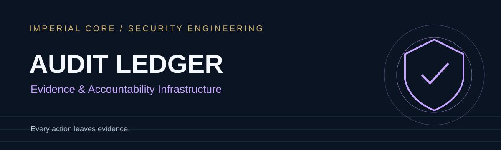

<p align="center"></p>

# AUDIT LEDGER

**Evidence & Accountability Infrastructure · IMPERIAL Core**

*Every action leaves evidence.*

Hash-chained synthetic event records and Ed25519-signed checkpoints with independent verification of exact length and terminal digest.

**Status: LOCAL TESTED REFERENCE / INDEPENDENT QA PENDING.** No production deployment, certification or real Owner enrollment is claimed.

## Quick start

Node.js 22.13+; no external dependencies or paid services. The local run in this iteration used Node.js 24.22.1.

```sh
npm test
```

Use `SQLiteLedger` for the local persistent reference. The lower-level in-memory API remains `append(entries, event); checkpoint(entries, privateKey); verifyLedger(entries, receipt, publicKey)`.

- [Architecture and release gates](ARCHITECTURE.md)
- [Threat model](THREAT_MODEL.md)
- [Security policy](SECURITY.md)
- [Source](src/index.mjs) · [Tests](test/reference.test.mjs) · [Local test evidence](evidence/LOCAL_TEST_EVIDENCE.md)
- [Authorship](AUTHORS.md) · [Roadmap](ROADMAP.md)

## Limitations

The local SQLite ledger and signed Merkle inclusion checks are reference implementations. There is no external witness, trusted timestamp, tenant authentication, WORM storage or production immutability. A trusted externally retained checkpoint is necessary to detect history replacement.

## Related components

[ZERO TRUST](https://github.com/oromaskevic23-cmd/ZERO-TRUST) · [GUARDIAN CORE](https://github.com/oromaskevic23-cmd/GUARDIAN-CORE) · [APPROVAL GATEWAY](https://github.com/oromaskevic23-cmd/APPROVAL-GATEWAY) · [AUDIT LEDGER](https://github.com/oromaskevic23-cmd/AUDIT-LEDGER) · [CYBER HAK](https://github.com/oromaskevic23-cmd/CYBER-HAK-Public)

## Founder and authorship

<p align="center"></p>

**Alexander Nikolaevich Romaskevich (RomaskevicH)** — Founder • Owner • CEO, IMPERIAL Core. Architect / Final Architectural Decision Authority.

Public source visibility is not a license grant. See [LICENSE](LICENSE).

**Architecture Before Implementation. Evidence Before Trust.**

## Local persistent evidence

[SQLiteLedger](src/sqlite-ledger.mjs) stores synthetic digest-only events in a scoped local SQLite file, checks the full hash chain and can verify a prefix against a separately retained signed Merkle checkpoint. The checkpoint and trusted public key must be kept outside the database's trust domain. A deleted or replaced ledger cannot be detected without that retained evidence. This reference scans the chain on every append and is not a scalable or immutable production ledger.

SQLite files are created with owner-only POSIX permissions; existing files with broader permissions and symlinks are rejected on POSIX. Use a trusted directory and protect the database against replacement. Windows ACL enforcement is not implemented or tested. A synthetic cross-component check is available with `node --test integration/*.test.mjs` when all four repository directories are present as siblings; it does not prove production integration.

## Security hardening v0.2

[Implementation](src/merkle.mjs) · [Tests](test/merkle.test.mjs) · [Evidence and limitations](docs/HARDENING_V0_2.md).

## Security composition v0.3

Signed Merkle checkpoints bind organization, ledger identity, size and root; verification checks all of these against trusted context. Inclusion is not a consistency proof, external witness, timestamp or proof against signer equivocation.

[Implementation](src/signed-merkle.mjs) · [Tests](test/signed-merkle.test.mjs) · [Scope and evidence](docs/COMPOSITION_V0_3.md).
